# Elevator Simulation (LabVIEW State Machine)

A two-floor elevator controller in LabVIEW, built on the **state machine design pattern**.
Passengers call the car with **Up** (at Level 1) or **Down** (at Level 2). The controller opens and closes the doors, moves the car between floors, latches calls made while it is busy, and serves them once the current operation finishes.

<p align="center">
  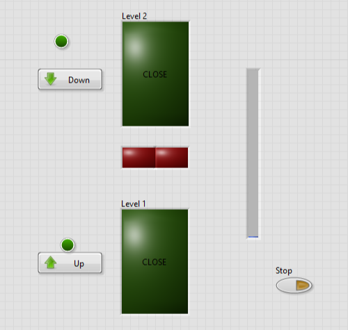
  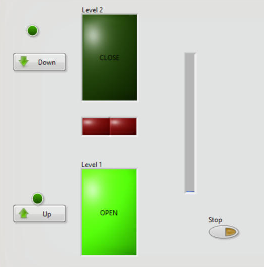
  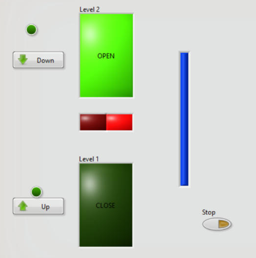
</p>

## Highlights

- **7-state machine**: a While Loop, a Case structure with one case per state, and shift registers that carry the next state, the elevator data and the error cluster.
- **Type definitions** (`State.ctl` enum and `Data.ctl` cluster), so a change to a state or a data field updates every case.
- **Event decoding**: the car position and both call buttons are packed into a 3-bit status code with `Build Array` and `Boolean Array To Number`, and an 8-frame Case structure picks the next state from that code.
- **Non-blocking timing**: a shared 250-tick counter times each door cycle and each trip, so the UI stays responsive and new calls are latched mid-operation.
- **Live front panel**: door indicators (OPEN/CLOSE), direction lights, call lights, and a progress bar that shows the car's position.

## How it works

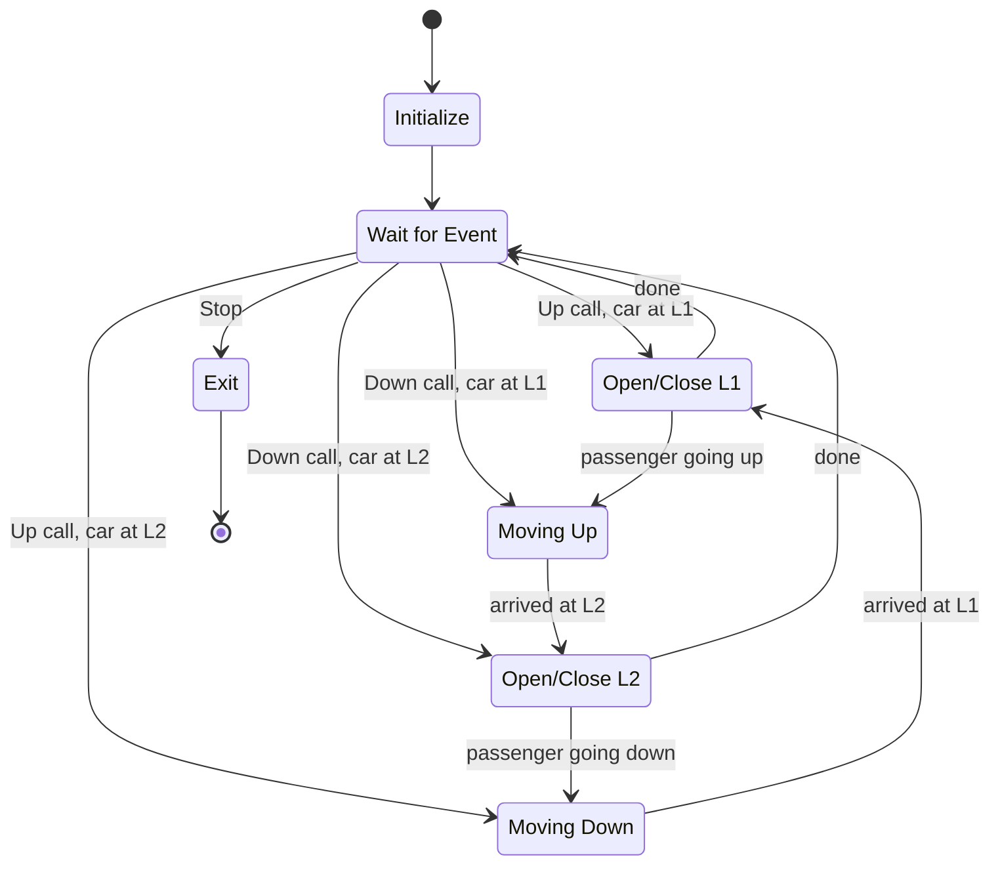

| State | What it does |
|---|---|
| **Initialize** | Car at Level 1, doors closed, counter 0, all flags cleared |
| **Wait for Event** | Latches button presses. While the counter is running it returns to the previous state; when idle it decodes the status code and picks the next state |
| **Open/Close L1 / L2** | Holds that floor's door open for one counter cycle, clears the call, then hands over to the move (if a passenger is riding) or back to waiting |
| **Moving Up / Down** | Counts down the trip, updates the position bar, sets the new level on arrival, and opens the destination door |
| **Exit** | Clears the data and stops the loop |

### Status code decoding (Wait for Event)

`code = Up × 4 + Down × 2 + (Level ≠ 1) × 1`

| Code | Up | Down | Car at L2 | Next state |
|---|---|---|---|---|
| 0, 1 | – | – | – | Wait for Event |
| 2 | F | T | F | Moving Up |
| 3 | F | T | T | Open/Close L2 |
| 4 | T | F | F | Open/Close L1 |
| 5 | T | F | T | Moving Down |
| 6 | T | T | F | Open/Close L1 |
| 7 | T | T | T | Open/Close L2 |

When both buttons are pressed, the floor the car is already on is served first. Every active code also loads the counter with 250. With a 10 ms loop wait, one door cycle or trip takes about 5 seconds.

## Block diagram

| | |
|---|---|
| 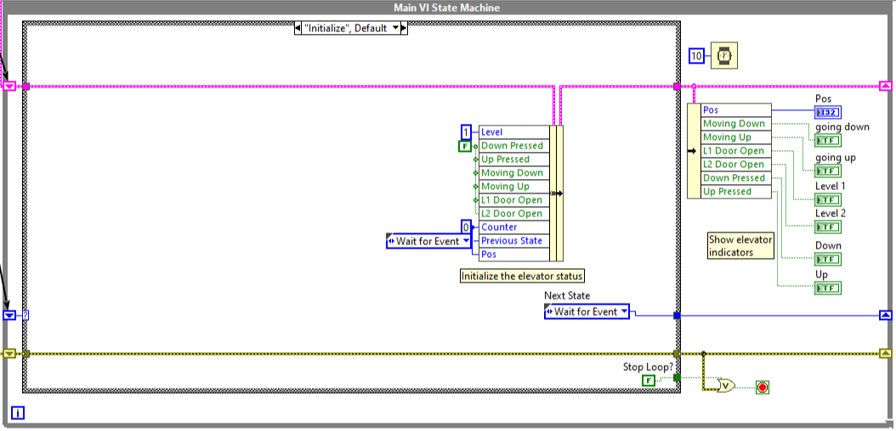 | 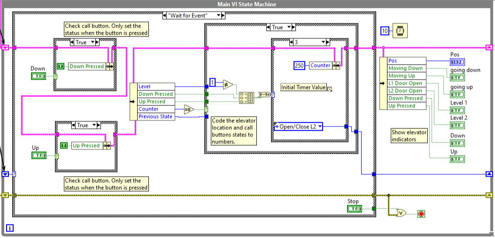 |
| **Initialize** | **Wait for Event** |
| 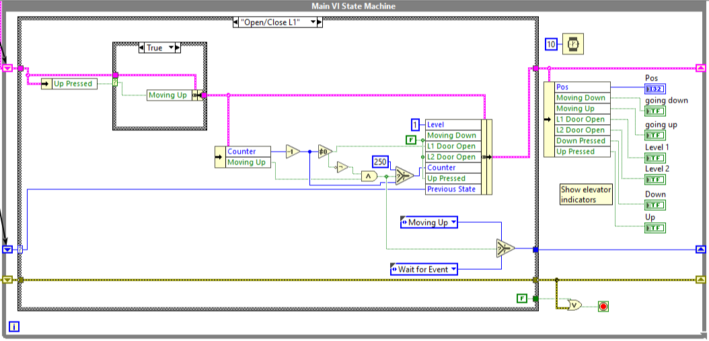 | 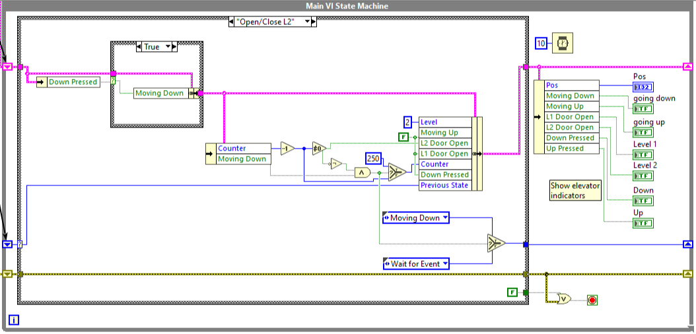 |
| **Open/Close L1** | **Open/Close L2** |
| 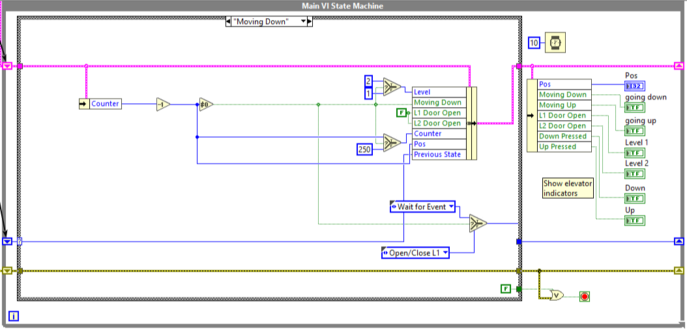 | 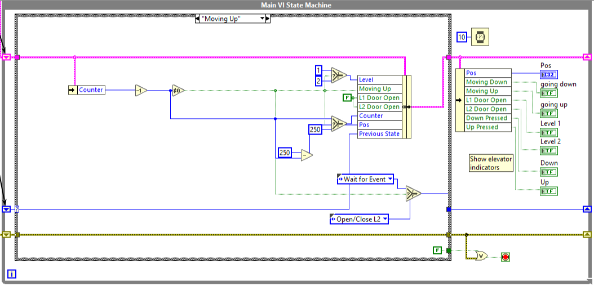 |
| **Moving Down** | **Moving Up** |
| 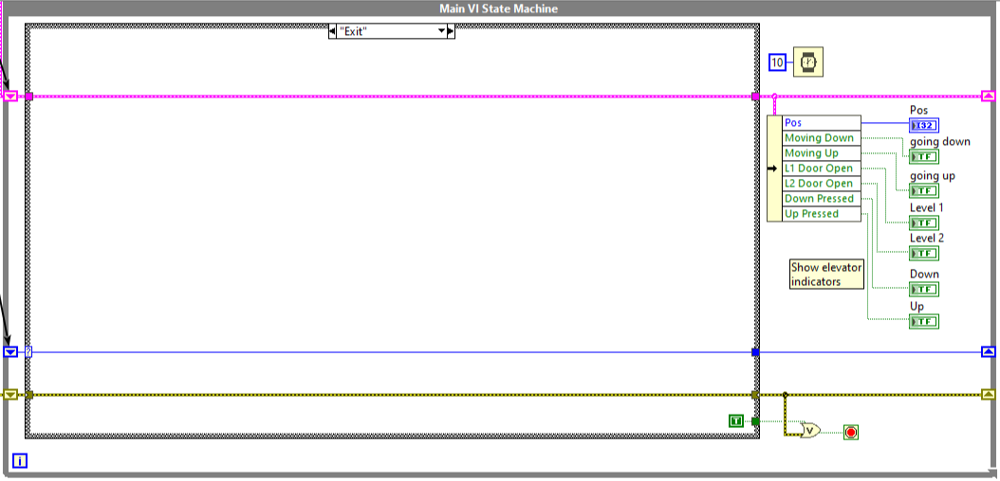 | |
| **Exit** | |

## Testing

I tested the running VI against these scenarios:

1. Starts at Level 1 with both doors closed and the position at 0.
2. **Up** at L1: the L1 door cycles, the car rises, and the L2 door cycles.
3. **Down** at L2: the L2 door cycles, the car descends, and the L1 door cycles.
4. **Down** while the car is at L1: the car goes up to collect the passenger, then brings them down.
5. Both buttons pressed: the current floor is served first, then the other.
6. A call pressed during a move latches and is served afterwards.
7. **Stop** ends the loop through the Exit state.

## Running it

1. Install **LabVIEW 2026** or later. The VIs are saved in that version and won't open in older releases.
2. Clone this repository and open `src/Elevator Simulation.lvproj`.
3. Open `Main.vi` and press **Run** (Ctrl+R). Use **Up** and **Down** to call the car and **Stop** to exit.

## Project structure

```
src/
  Elevator Simulation.lvproj   LabVIEW project
  Main.vi                      State machine (front panel + block diagram)
  controls/
    State.ctl                  Enum type definition: the 7 states
    Data.ctl                   Cluster type definition: elevator data
docs/images/                   Front panel and block diagram screenshots
```

## Skills demonstrated

LabVIEW · state machine design · type definitions · Boolean logic and decoding · timing and concurrency on a single loop · front panel (HMI) design · test planning
